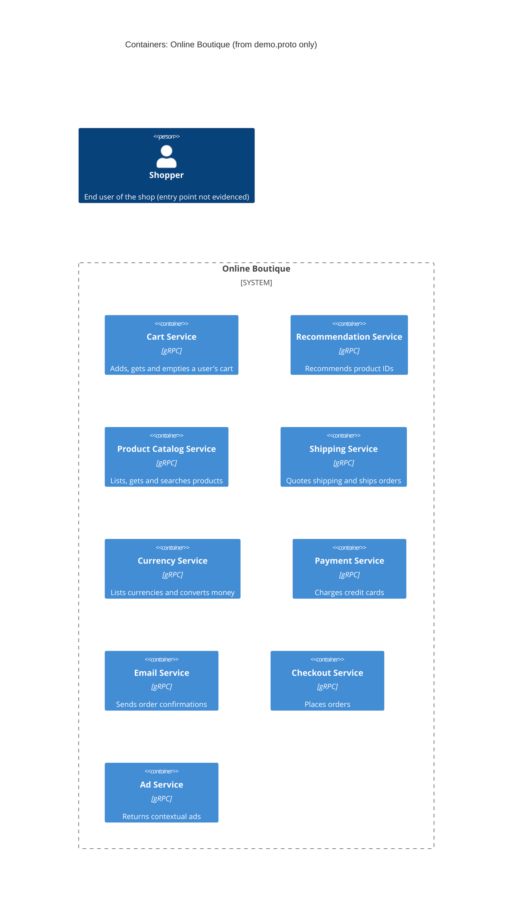

# Task 1 (run A): Recovered architecture of Online Boutique

## 1. Agent

Claude Code (Anthropic), model Claude Opus 5.5 (`claude-opus-5-5`).

## 2. Files read

- `prompts/1-recover-architecture.md` (task file)
- `system/online-boutique/protos/demo.proto` (the only evidence)

## 3. Containers table

All containers below come from a `service` block in the proto. The proto defines **interfaces only**. It does not show implementation languages, deployment units or data stores.

| Container | Technology / language | Responsibility | Evidence |
|---|---|---|---|
| Cart Service | gRPC (proto3 interface). Language not evidenced | Add items to a user's cart, get the cart, empty it | `system/online-boutique/protos/demo.proto` (`service CartService`: `AddItem`, `GetCart`, `EmptyCart`) |
| Recommendation Service | gRPC (proto3). Language not evidenced | Recommend product IDs for a user and a list of products | `demo.proto` (`service RecommendationService`: `ListRecommendations`) |
| Product Catalog Service | gRPC (proto3). Language not evidenced | List, get and search products (id, name, description, picture, price, categories) | `demo.proto` (`service ProductCatalogService`: `ListProducts`, `GetProduct`, `SearchProducts`; `message Product`) |
| Shipping Service | gRPC (proto3). Language not evidenced | Quote shipping cost for an address and items; ship an order and return a tracking ID | `demo.proto` (`service ShippingService`: `GetQuote`, `ShipOrder`) |
| Currency Service | gRPC (proto3). Language not evidenced | List supported currencies; convert `Money` between ISO 4217 currencies | `demo.proto` (`service CurrencyService`: `GetSupportedCurrencies`, `Convert`) |
| Payment Service | gRPC (proto3). Language not evidenced | Charge a credit card for an amount and return a transaction ID | `demo.proto` (`service PaymentService`: `Charge`; `message CreditCardInfo`) |
| Email Service | gRPC (proto3). Language not evidenced | Send an order confirmation email | `demo.proto` (`service EmailService`: `SendOrderConfirmation`) |
| Checkout Service | gRPC (proto3). Language not evidenced | Place an order (user, currency, address, email, card) and return an `OrderResult` | `demo.proto` (`service CheckoutService`: `PlaceOrder`) |
| Ad Service | gRPC (proto3). Language not evidenced | Return text ads for a set of context keywords | `demo.proto` (`service AdService`: `GetAds`) |

Note: `option go_package = ".../hipstershop"` (line 19) only sets the import path for Go stubs generated from this file. It does **not** show that any service is written in Go.

## 4. Dependencies table

| Caller → callee | Protocol | Evidence |
|---|---|---|
| *None evidenced* | — | A `.proto` file declares which RPCs each service **offers**. It does not declare which service **calls** which. No client addresses, environment variables or call sites are in the evidence. |

Possible dependencies suggested by shared message types are listed under **Gaps** as **[Inferred]**.

## 5. Mermaid diagram

The diagram matches the tables: nine gRPC containers and no `Rel`, because the evidence proves no runtime dependency. The end user is shown as required by the template. No relationship from the user is drawn, because the evidence does not show which container the user talks to.

## 6. Gaps

| Gap | What the proto hints (if anything) | File that would settle it |
|---|---|---|
| Who calls whom (the whole dependency graph) | **[Inferred]** `PlaceOrderRequest` carries `CreditCardInfo`, `Address`, `email` and `user_currency`, and `PlaceOrderResponse` returns `OrderResult` with `shipping_tracking_id`. That suggests `CheckoutService` calls Cart, Product Catalog, Currency, Shipping, Payment and Email. This is not proven. | `system/online-boutique/kubernetes-manifests/checkoutservice.yaml` (`*_SERVICE_ADDR` env vars) or the checkout source code |
| User-facing entry point (web frontend / UI) | No frontend service is defined in the proto. A UI is probably what calls the services, but it is not in the evidence. **[Inferred]** | `system/online-boutique/kubernetes-manifests/frontend.yaml`, frontend source code |
| Protocol between user and system (HTTP/HTTPS) | Not evidenced in the provided files | Frontend manifest (Service / ports) or frontend source |
| Implementation language of each service | Not evidenced. `go_package` is only a code-generation option | Each service's source folder or Dockerfile under `system/online-boutique/src/` |
| Data stores (e.g. where carts or products are kept) | Not evidenced in the provided files. The Cart Service holds per-user state, so it probably has a store **[Inferred]** | `system/online-boutique/kubernetes-manifests/` (e.g. a cart DB/cache manifest), cart service source |
| External systems (real payment gateway, real email provider) | Not evidenced. `Charge` and `SendOrderConfirmation` could be real or mocked | Payment and email service source code |
| Whether each `service` is a separately deployed container | Not evidenced. The proto groups interfaces; deployment boundaries are not shown | `system/online-boutique/kubernetes-manifests/` (one Deployment per service?) |
| Load generator or other non-gRPC components | Not evidenced in the provided files | `system/online-boutique/kubernetes-manifests/`, `system/online-boutique/src/` listing |
