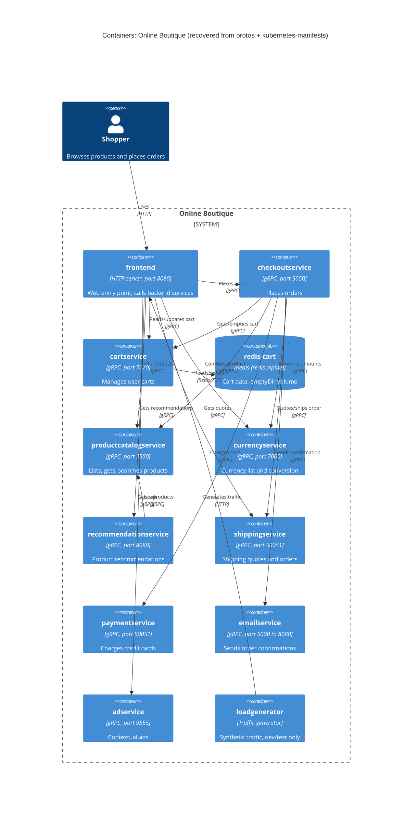

# 1B: Recovered C4 container architecture of Online Boutique

Run: **B**. Evidence allowed: `system/online-boutique/protos/demo.proto`, `system/online-boutique/kubernetes-manifests/`

## 1. Agent

Claude Code (Anthropic CLI agent), model **Claude Opus 5.5** (`claude-opus-5-5`).

## 2. Files read

Besides the task file `prompts/1-recover-architecture.md`:

- `system/online-boutique/protos/demo.proto`
- `system/online-boutique/kubernetes-manifests/kustomization.yaml`
- `system/online-boutique/kubernetes-manifests/README.md`
- `system/online-boutique/kubernetes-manifests/frontend.yaml`
- `system/online-boutique/kubernetes-manifests/adservice.yaml`
- `system/online-boutique/kubernetes-manifests/cartservice.yaml`
- `system/online-boutique/kubernetes-manifests/checkoutservice.yaml`
- `system/online-boutique/kubernetes-manifests/currencyservice.yaml`
- `system/online-boutique/kubernetes-manifests/emailservice.yaml`
- `system/online-boutique/kubernetes-manifests/paymentservice.yaml`
- `system/online-boutique/kubernetes-manifests/productcatalogservice.yaml`
- `system/online-boutique/kubernetes-manifests/recommendationservice.yaml`
- `system/online-boutique/kubernetes-manifests/shippingservice.yaml`
- `system/online-boutique/kubernetes-manifests/loadgenerator.yaml`

Note: no terminal commands were allowed, so I could not list the folder. I opened the files named in `kustomization.yaml` (`resources:`), plus `loadgenerator.yaml` (commented out there) and `README.md`. Any other file in the folder was not read (see **Gaps**).

## 3. Containers table

Implementation language is **Not evidenced in the provided files** for every service: each manifest gives only a bare image name (e.g. `image: frontend`), and `demo.proto` has only `go_package`, which names a Go package path for generated stubs, not the language of any service.

| Container | Technology / language | Responsibility | Evidence |
|---|---|---|---|
| `frontend` | HTTP server on :8080 (port name `http`), exposed through a `LoadBalancer` Service; language not evidenced | Web entry point for shoppers; calls the backend services | `kubernetes-manifests/frontend.yaml` (Service `frontend-external` `type: LoadBalancer`; `httpGet` probes on `/_healthz`; `shop_session-id` cookie) |
| `productcatalogservice` | gRPC server on :3550; language not evidenced | List, get and search products | `kubernetes-manifests/productcatalogservice.yaml` (port `grpc` 3550); `protos/demo.proto` (`service ProductCatalogService`: `ListProducts`, `GetProduct`, `SearchProducts`) |
| `currencyservice` | gRPC server on :7000; language not evidenced | Supported currencies and currency conversion | `kubernetes-manifests/currencyservice.yaml` (port `grpc` 7000); `protos/demo.proto` (`service CurrencyService`: `GetSupportedCurrencies`, `Convert`) |
| `cartservice` | gRPC server on :7070; language not evidenced | Add items, get cart, empty cart per user | `kubernetes-manifests/cartservice.yaml` (port `grpc` 7070); `protos/demo.proto` (`service CartService`: `AddItem`, `GetCart`, `EmptyCart`) |
| `redis-cart` | Redis (`redis:alpine`), :6379, `emptyDir` volume (not persistent) | Cart data store for `cartservice` | `kubernetes-manifests/cartservice.yaml` (Deployment `redis-cart`, `image: redis:alpine`, `volumes: redis-data emptyDir`) |
| `recommendationservice` | gRPC server on :8080; language not evidenced | Recommend product IDs for a user / product list | `kubernetes-manifests/recommendationservice.yaml` (port `grpc` 8080); `protos/demo.proto` (`service RecommendationService`: `ListRecommendations`) |
| `shippingservice` | gRPC server on :50051; language not evidenced | Shipping quotes and shipping orders (tracking ID) | `kubernetes-manifests/shippingservice.yaml` (port `grpc` 50051); `protos/demo.proto` (`service ShippingService`: `GetQuote`, `ShipOrder`) |
| `checkoutservice` | gRPC server on :5050; language not evidenced | Place an order (orchestrates cart, pricing, shipping, payment, email) | `kubernetes-manifests/checkoutservice.yaml` (port `grpc` 5050; six `*_SERVICE_ADDR` env vars); `protos/demo.proto` (`service CheckoutService`: `PlaceOrder`) |
| `paymentservice` | gRPC server on :50051; language not evidenced | Charge a credit card, return transaction ID | `kubernetes-manifests/paymentservice.yaml` (port `grpc` 50051); `protos/demo.proto` (`service PaymentService`: `Charge`) |
| `emailservice` | gRPC server (Service :5000 → container :8080); language not evidenced | Send order confirmation | `kubernetes-manifests/emailservice.yaml` (Service port `grpc` 5000, `targetPort: 8080`); `protos/demo.proto` (`service EmailService`: `SendOrderConfirmation`) |
| `adservice` | gRPC server on :9555; language not evidenced | Return ads for context keywords | `kubernetes-manifests/adservice.yaml` (port `grpc` 9555); `protos/demo.proto` (`service AdService`: `GetAds`) |
| `loadgenerator` | Traffic generator (`USERS=10`, `RATE=1`); language not evidenced. Not in `kustomization.yaml` (commented out) | Synthetic user traffic against `frontend` (dev/test only) | `kubernetes-manifests/loadgenerator.yaml`; `kubernetes-manifests/kustomization.yaml` (`# - loadgenerator.yaml`) |

Protocol basis: each backend Service names its port `grpc` and uses `grpc:` readiness and liveness probes. Each one matches a `service` in `demo.proto`.

## 4. Dependencies table

All paths are relative to `system/online-boutique/`. Callee protocol comes from the callee's Service port name and its `grpc` probes. Which RPCs each caller uses is **Not evidenced in the provided files** (the proto defines the RPCs, not who calls them).

| Caller → Callee | Protocol | Evidence |
|---|---|---|
| Shopper → `frontend` | HTTP | `kubernetes-manifests/frontend.yaml` (Service `frontend-external`, `type: LoadBalancer`, port name `http` 80 → 8080) |
| `loadgenerator` → `frontend` | HTTP | `kubernetes-manifests/loadgenerator.yaml` (`FRONTEND_ADDR=frontend:80`; init container `wget http://${FRONTEND_ADDR}`) |
| `frontend` → `productcatalogservice` | gRPC | `kubernetes-manifests/frontend.yaml` (`PRODUCT_CATALOG_SERVICE_ADDR=productcatalogservice:3550`) |
| `frontend` → `currencyservice` | gRPC | `kubernetes-manifests/frontend.yaml` (`CURRENCY_SERVICE_ADDR=currencyservice:7000`) |
| `frontend` → `cartservice` | gRPC | `kubernetes-manifests/frontend.yaml` (`CART_SERVICE_ADDR=cartservice:7070`) |
| `frontend` → `recommendationservice` | gRPC | `kubernetes-manifests/frontend.yaml` (`RECOMMENDATION_SERVICE_ADDR=recommendationservice:8080`) |
| `frontend` → `shippingservice` | gRPC | `kubernetes-manifests/frontend.yaml` (`SHIPPING_SERVICE_ADDR=shippingservice:50051`) |
| `frontend` → `checkoutservice` | gRPC | `kubernetes-manifests/frontend.yaml` (`CHECKOUT_SERVICE_ADDR=checkoutservice:5050`) |
| `frontend` → `adservice` | gRPC | `kubernetes-manifests/frontend.yaml` (`AD_SERVICE_ADDR=adservice:9555`) |
| `checkoutservice` → `productcatalogservice` | gRPC | `kubernetes-manifests/checkoutservice.yaml` (`PRODUCT_CATALOG_SERVICE_ADDR=productcatalogservice:3550`) |
| `checkoutservice` → `shippingservice` | gRPC | `kubernetes-manifests/checkoutservice.yaml` (`SHIPPING_SERVICE_ADDR=shippingservice:50051`) |
| `checkoutservice` → `paymentservice` | gRPC | `kubernetes-manifests/checkoutservice.yaml` (`PAYMENT_SERVICE_ADDR=paymentservice:50051`) |
| `checkoutservice` → `emailservice` | gRPC | `kubernetes-manifests/checkoutservice.yaml` (`EMAIL_SERVICE_ADDR=emailservice:5000`) |
| `checkoutservice` → `currencyservice` | gRPC | `kubernetes-manifests/checkoutservice.yaml` (`CURRENCY_SERVICE_ADDR=currencyservice:7000`) |
| `checkoutservice` → `cartservice` | gRPC | `kubernetes-manifests/checkoutservice.yaml` (`CART_SERVICE_ADDR=cartservice:7070`) |
| `recommendationservice` → `productcatalogservice` | gRPC | `kubernetes-manifests/recommendationservice.yaml` (`PRODUCT_CATALOG_SERVICE_ADDR=productcatalogservice:3550`) |
| `cartservice` → `redis-cart` | Redis protocol (TCP) | `kubernetes-manifests/cartservice.yaml` (`REDIS_ADDR=redis-cart:6379`; Service port name `tcp-redis`) |

`adservice`, `currencyservice`, `emailservice`, `paymentservice`, `productcatalogservice` and `shippingservice` declare no `*_ADDR` env vars, so they have no outgoing dependencies in this evidence.

## 5. Mermaid diagram

The Rel labels name the purpose of each call. I matched each one to the callee's RPC names in `demo.proto` **[Inferred]**: the evidence shows the connection, not which RPC is called.

## 6. Gaps

| Gap | What would settle it |
|---|---|
| Implementation language of each service | Each service's source folder or Dockerfile (e.g. `system/online-boutique/src/<service>/Dockerfile`) |
| Which RPCs each caller actually invokes (e.g. does `frontend` call `ShippingService.GetQuote` only?) | Client code in `system/online-boutique/src/frontend/` and `src/checkoutservice/` |
| `shoppingassistantservice`: `frontend.yaml` sets `SHOPPING_ASSISTANT_SERVICE_ADDR=shoppingassistantservice:80`, but no manifest for it was read, and `kustomization.yaml` has `# - ../kustomize/components/shopping-assistant` commented out. Left out of the diagram. | `system/online-boutique/kustomize/components/shopping-assistant/` and `src/frontend/` (whether the call is gated by `ENABLE_ASSISTANT`, which is commented out) |
| Optional "packaging service" (`PACKAGING_SERVICE_URL`, commented out in `frontend.yaml`). Left out. | Frontend source / the Google Cloud demo docs |
| Optional data stores (Memorystore, AlloyDB, Spanner) and other components listed as commented-out `components:` in `kustomization.yaml`. Not part of this default deployment. | `system/online-boutique/kustomize/components/*` |
| Whether `paymentservice` calls a real payment provider, or `emailservice` a real mail server (no external systems are evidenced, so no `System_Ext` was drawn) | `src/paymentservice/` and `src/emailservice/` source |
| Whether `productcatalogservice`, `currencyservice` and `adservice` have their own data stores (no store or env var in the manifests suggests one) | Their source folders (e.g. a bundled products/currency data file) |
| Whether the frontend talks gRPC to the backends: shown as gRPC because the callee Services name their ports `grpc`. The client side is not shown. | `src/frontend/` client code |
| Other files in `kubernetes-manifests/` that are not listed in `kustomization.yaml` (I could not list the directory) | A directory listing of `system/online-boutique/kubernetes-manifests/` |
| Real image tags and registries (README says the manifests need `skaffold` to insert them) | `system/online-boutique/skaffold.yaml` or `release/kubernetes-manifests.yaml` |
